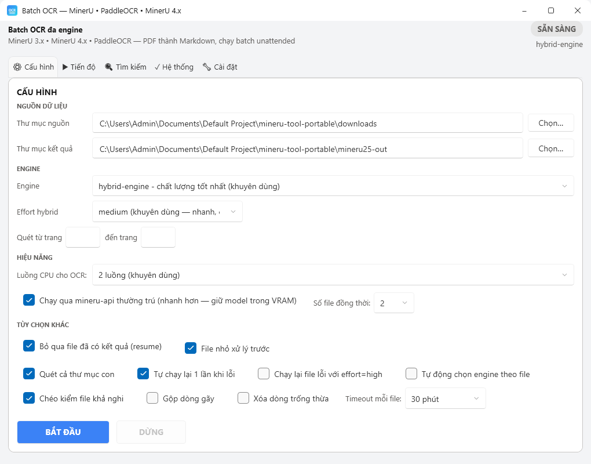
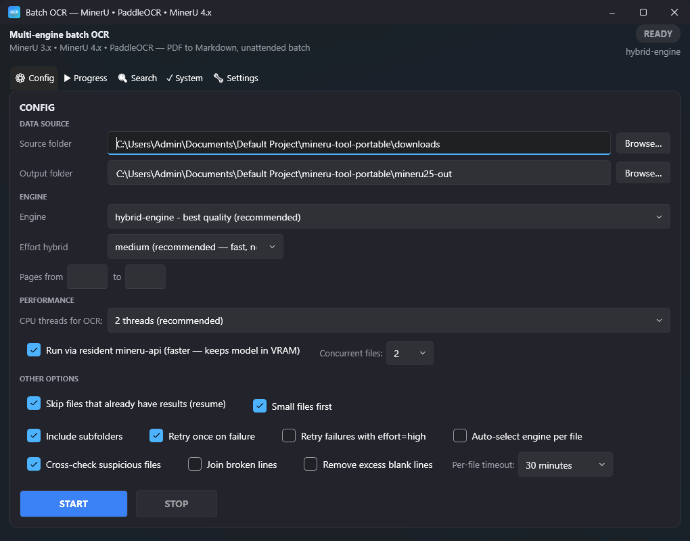

# MinerU25Tool — Multi-Engine Batch OCR for Windows

**[Tiếng Việt](README.vi.md)**

A Windows WPF (.NET 8) tool that batch-converts PDF files to Markdown with
multiple OCR engines, unattended batch runs (resume, pause, auto-shutdown),
Vietnamese/English UI and light/dark themes.

> **Engine baseline:** MinerU **4.2.3**, using the VLM
> `MinerU2.5-Pro-2605-1.2B`. The "2.5" is the *model* generation, not the app
> version — MinerU 4.x is the current release. MinerU 3.x remains available as
> a legacy engine.




## Features

- **OCR engines**: `hybrid-engine` (recommended), `vlm-engine`, `pipeline` (PP-OCR),
  `vlm-http-client` / `hybrid-http-client` (remote GPU server),
   `paddleocr` (PP-StructureV3, light VRAM, merged single `.md` per file via
   `paddle_run.py` with seal/formula/chart modules off), `mineru4x` (MinerU 4.x resident server),
  `windows-ocr` (built-in WinRT OCR, free, CPU).
- **Batch**: 1–3 files in parallel via resident `mineru-api`, resume (`.done` markers),
  retry-on-failure (optional effort boost), per-file timeout, **pause/resume**,
  automatic quality check (flags SUSPICIOUS files + cross-checks with a 2nd engine).
- **Outputs**: `.md` + plain `.txt` (+ images, tables) per file, `batch-report.html`,
  `batch-log.txt`, `batch-state.json`.
- **Automation**: smart per-file engine routing (text/scan), watch folder
  (new PDFs run automatically), shutdown when done, sound notification,
  start-with-Windows.
- **Search**: full-text search across all scanned `.md` files.
- **System tab**: per-component checklist (red = required, yellow = optional),
  **install all or one-by-one** via pip/venvs automatically.
- **Remote GPU farm**: offload a whole library to **Colab / Kaggle** GPUs via
  [`remote/`](remote/README.md) — the local PC serves PDFs through a Cloudflare
  tunnel, workers run MinerU 4.2.3 / PaddleOCR-VL / dots.ocr and return markdown.
  No 25 GB cloud upload, no extra account, resumable across sessions.
- **Interface**: 5 tabs (Config, Progress, Search, System, Settings), font size
  80–150%, background transparency, always-on-top, F1 help, CLI mode
  (`--autostart --src --out --engine`).

## Requirements

- Windows 10/11 x64. [.NET 8 SDK](https://dotnet.microsoft.com/download) (build only).
- Python 3.10+ for the engines — use the **System** tab → **Check** →
  **Auto-install** inside the app.
- NVIDIA GPU recommended (CPU works, much slower).

## Build & run

```powershell
dotnet build -c Release
dotnet publish -c Release -r win-x64 --self-contained true -p:PublishSingleFile=true -o publish
```

Launch `MinerU25Tool.exe`, open the **System** tab → **Check** → **Auto-install**
if anything is missing, pick a PDF folder and press **START**.
See [HUONG-DAN.txt](HUONG-DAN.txt) (Vietnamese) for detailed usage.

## Docs

- `HUONG-DAN.txt` — usage guide (Vietnamese).
- `docs/HUONG-DAN-GPU-TU-XA.md` — run VLM on a rented remote GPU.
- [`remote/README.md`](remote/README.md) — **Remote GPU farm**: convert a large
  library on Colab / Kaggle T4 while the local PC only serves files.
- [`docs/so-sanh-cong-cu-ocr-2026.md`](docs/so-sanh-cong-cu-ocr-2026.md) —
  benchmark-based comparison of MinerU-class OCR/document-parsing tools
  (OmniDocBench + MDPBench Vietnamese), with a shortlist for this library.

## Remote GPU (Colab / Kaggle)

For libraries too large for the local GPU (e.g. 2,000+ PDFs / 25 GB), run the
whole batch on free T4 GPUs:

```powershell
cd remote
python coordinator.py plan  --src "F:\books" --out "F:\books-ocr"
python coordinator.py serve --src "F:\books" --out "F:\books-ocr" --tunnel
# paste the printed URL + TOKEN into docs/colab/Tiner_Remote_Colab.ipynb
# (or the Kaggle kernel in docs/colab/remote_worker/), then Run All
python coordinator.py status
python coordinator.py merge --out "F:\books-ocr"
```

The local machine keeps the PDFs and a small SQLite queue; workers pull page
chunks over a Cloudflare tunnel, OCR them on GPU, and push `main.md` + assets
back. Multiple Colab/Kaggle sessions can run at once; jobs are claimed once and
retried up to 3 times. See [`remote/README.md`](remote/README.md).

## Screenshots

| Config | Dark mode |
|---|---|
|  |  |

More screenshots (Vietnamese UI) in [README.vi.md](README.vi.md).

## License

MIT — see [LICENSE](LICENSE).
