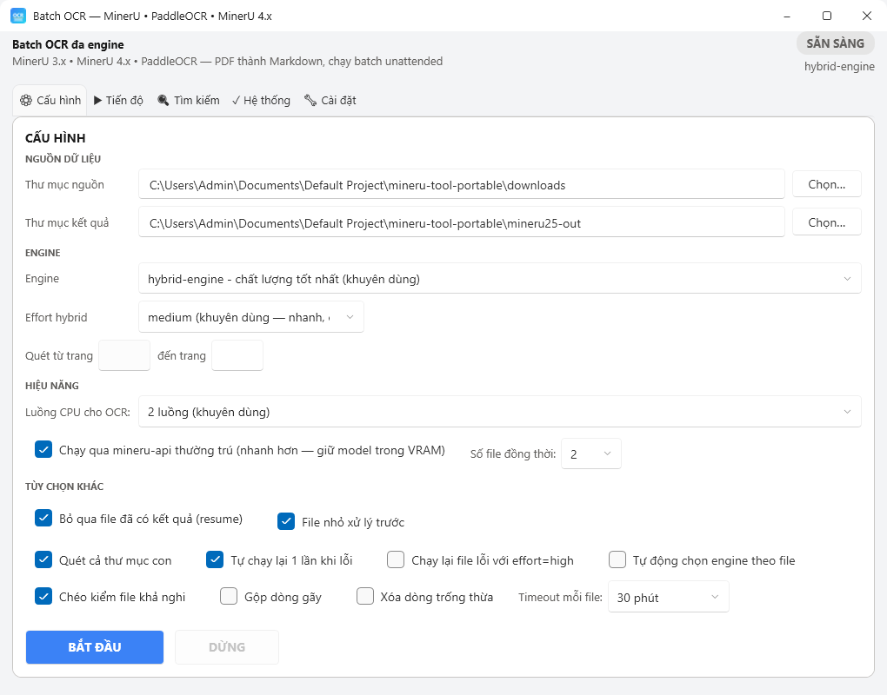
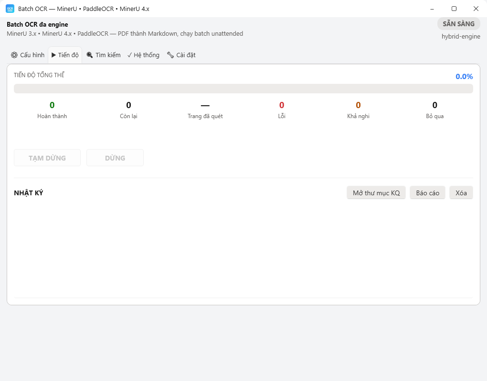
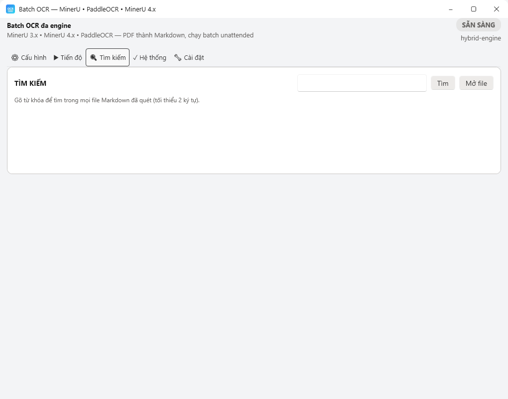
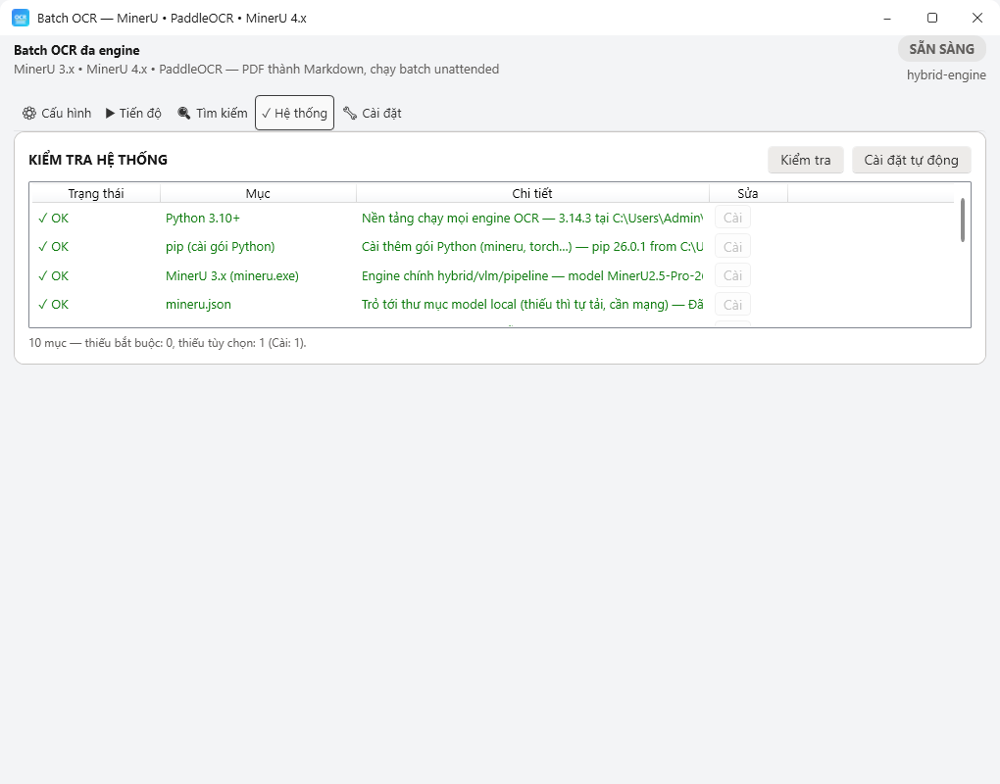
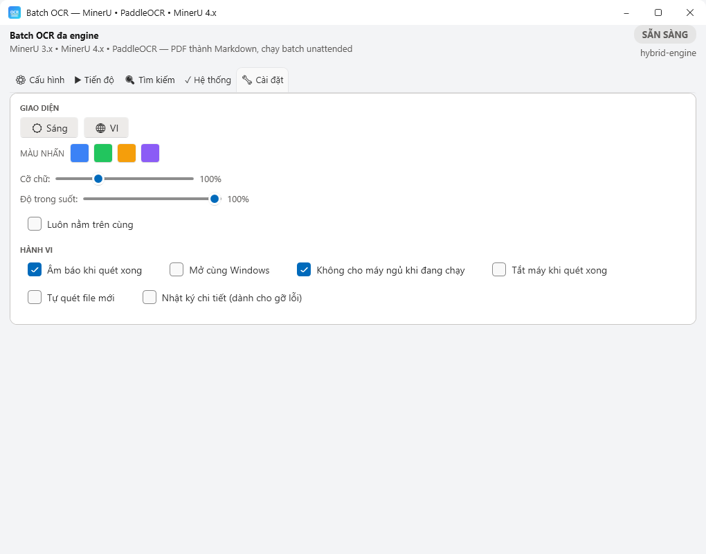
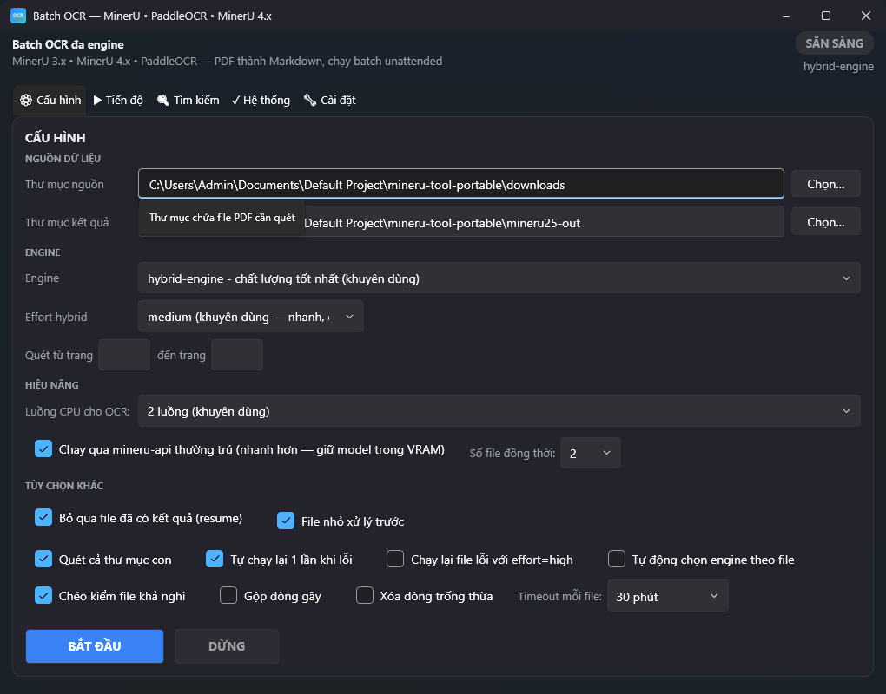

# MinerU25Tool — Batch OCR đa engine cho Windows

**[English](README.md)**

Tool WPF (.NET 8) chạy OCR hàng loạt file PDF thành Markdown, hỗ trợ nhiều engine,
chạy batch unattended (tự resume, tạm dừng, tự tắt máy), giao diện Việt/Anh,
Sáng/Tối.

> **Engine nền:** MinerU **4.2.3**, dùng model VLM
> `MinerU2.5-Pro-2605-1.2B`. Chữ "2.5" là *thế hệ model*, không phải phiên bản
> ứng dụng — MinerU 4.x mới là bản hiện hành. MinerU 3.x vẫn còn ở chế độ
> tương thích.




## Tính năng

- **Engines**: `hybrid-engine` (khuyên dùng), `vlm-engine`, `pipeline` (PP-OCR),
  `vlm-http-client` / `hybrid-http-client` (server GPU từ xa),
   `paddleocr` (PP-StructureV3, VRAM nhẹ, gộp 1 `.md` mỗi file qua
   `paddle_run.py`, tắt module seal/formula/chart), `mineru4x` (MinerU 4.x server thường trú),
  `windows-ocr` (OCR có sẵn của Windows, miễn phí, CPU).
- **Batch**: song song 1–3 file qua `mineru-api` thường trú, resume (marker `.done`),
  chạy lại khi lỗi (tuỳ chọn nâng effort), timeout mỗi file, **tạm dừng/tiếp tục**,
  kiểm tra chất lượng tự động (đánh dấu KHA NGHI + chéo kiểm engine 2).
- **Kết quả**: `.md` + `.txt` thuần (+ ảnh, bảng) mỗi file, `batch-report.html`,
  `batch-log.txt`, `batch-state.json`.
- **Tự động**: smart routing theo file (text/scan), tự quét file mới,
  tắt máy khi xong, âm báo, mở cùng Windows.
- **Tìm kiếm**: tìm toàn văn trong mọi file `.md` đã quét.
- **Hệ thống**: bảng kiểm tra từng thành phần (đỏ = bắt buộc, vàng = tuỳ chọn),
  **cài toàn bộ hoặc từng mục** bằng pip/venv tự động.
- **Trang trại GPU từ xa**: đẩy cả thư viện lên GPU **Colab / Kaggle** qua
  [`remote/`](remote/README.md) — máy local chỉ phục vụ PDF qua Cloudflare
  Tunnel, worker quét bằng MinerU 4.2.3 / PaddleOCR-VL / dots.ocr rồi trả
  markdown về. Không upload 25 GB lên cloud, không cần tài khoản mới, có thể
  resume qua nhiều phiên.
- **Giao diện**: 5 tabs (Cấu hình, Tiến độ, Tìm kiếm, Hệ thống, Cài đặt),
  cỡ chữ 80–150%, nền xuyên thấu, luôn trên cùng, trợ giúp F1, chạy CLI
  (`--autostart --src --out --engine`).

## Yêu cầu

- Windows 10/11 x64. [.NET 8 SDK](https://dotnet.microsoft.com/download) (chỉ để build).
- Python 3.10+ cho engines — dùng tab **Hệ thống** → **Kiểm tra** →
  **Cài đặt tự động** ngay trong tool.
- Khuyên dùng GPU NVIDIA (không có vẫn chạy CPU, chậm hơn nhiều).

## Build & chạy

```powershell
dotnet build -c Release
dotnet publish -c Release -r win-x64 --self-contained true -p:PublishSingleFile=true -o publish
```

Mở `MinerU25Tool.exe`, vào tab **Hệ thống** → **Kiểm tra** → **Cài đặt tự động**
(nếu thiếu), chọn thư mục PDF rồi bấm **BẮT ĐẦU**.
Xem [HUONG-DAN.txt](HUONG-DAN.txt) để biết chi tiết.

## GPU từ xa (Colab / Kaggle)

Với thư viện quá lớn so với GPU local (ví dụ 2.000+ PDF / 25 GB), chạy cả lô
trên GPU T4 miễn phí:

```powershell
cd remote
python coordinator.py plan  --src "F:\books" --out "F:\books-ocr"
python coordinator.py serve --src "F:\books" --out "F:\books-ocr" --tunnel
# dán URL + TOKEN in ra vào docs/colab/Tiner_Remote_Colab.ipynb
# (hoặc kernel Kaggle trong docs/colab/remote_worker/), rồi Run All
python coordinator.py status
python coordinator.py merge --out "F:\books-ocr"
```

Máy local giữ PDF và hàng đợi SQLite nhỏ; worker tải từng khúc trang qua
Cloudflare Tunnel, quét trên GPU rồi gửi `main.md` + assets về. Chạy được nhiều
phiên Colab/Kaggle cùng lúc; mỗi job chỉ một worker nhận, thử lại tối đa 3 lần.
Xem [`remote/README.md`](remote/README.md).

## Tài liệu

- [`docs/so-sanh-cong-cu-ocr-2026.md`](docs/so-sanh-cong-cu-ocr-2026.md) — so
  sánh công cụ OCR/document parsing tương đương MinerU (OmniDocBench +
  MDPBench tiếng Việt), kèm shortlist cho thư viện này.
- [`remote/README.md`](remote/README.md) — trang trại GPU Colab/Kaggle.

## Ảnh giao diện

| Cấu hình | Tiến độ | Tìm kiếm |
|---|---|---|
|  |  |  |

| Hệ thống | Cài đặt | Chế độ tối |
|---|---|---|
|  |  |  |

## Giấy phép

MIT — xem [LICENSE](LICENSE).
